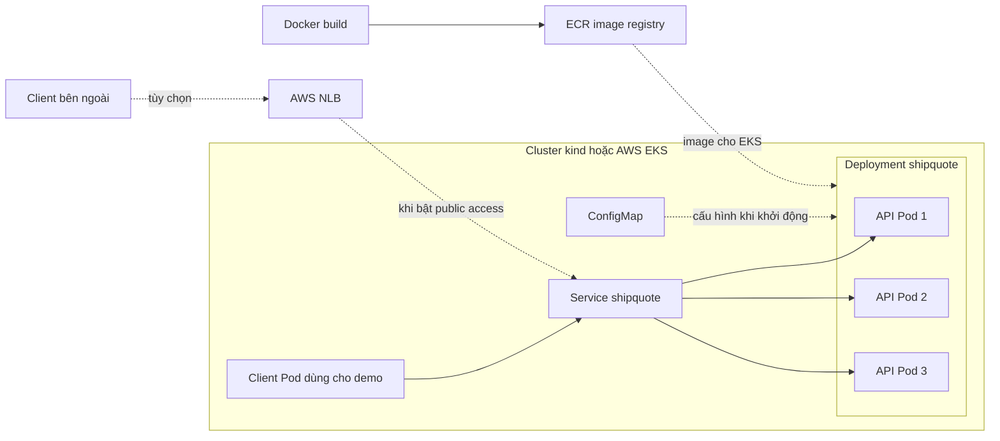

# ShipQuote

REST API tính phí vận chuyển bằng Node.js và Express, phục vụ mini project môn Cloud Computing về Kubernetes và triển khai trên AWS bằng EKS.

**Trạng thái:** phần application (thành viên 1) đã hiện thực bằng Node.js/Express, có tests và Dockerfile, đã kiểm chứng local và trong container ngày 2026-11-15. Kubernetes manifests và hạ tầng AWS chưa hiện thực; các mục đó bên dưới vẫn là hợp đồng triển khai dự kiến. Chỉ đánh dấu hoàn thành khi có kết quả kiểm chứng.

## Mục tiêu

Xây dựng một dịch vụ nhỏ để quan sát cách Kubernetes vận hành ứng dụng: phân phối traffic giữa nhiều replica, thay thế Pod bị xóa, kiểm tra sức khỏe, thay đổi số replica, cập nhật phiên bản và quản lý cấu hình.

Ứng dụng **stateless**: mỗi request có đủ dữ liệu để tính phí; không lưu báo giá hoặc session. Các replica dùng cùng phiên bản và cấu hình phải trả cùng kết quả nghiệp vụ. Metadata về Pod có thể khác nhau.

### Phạm vi

| Bắt buộc — MVP | Mở rộng sau MVP |
| --- | --- |
| REST API tính phí, đọc bảng giá, xem thông tin instance | OpenAPI và Swagger UI |
| Docker image chạy được trên Linux | HPA theo CPU và kịch bản tạo tải |
| Deployment gồm 3 replica và Service nội bộ | Endpoint công khai bằng AWS Network Load Balancer |
| ConfigMap, readiness/liveness probes, resource requests/limits | CI chạy test và build image |
| Demo scale, self-healing, probes, rollout và rollback | |
| Chạy trên kind và AWS EKS; có quy trình cleanup | |

Frontend, database, đăng nhập, thanh toán và quản lý đơn hàng nằm ngoài phạm vi MVP. HPA không phải điều kiện để hoàn thành bài tập. MPI, OpenMP và kernel HPC không thuộc phần hiện thực bắt buộc.

## Kiến trúc và công nghệ



Luồng build và phân phối image tách khỏi luồng HTTP. Local có thể nạp image trực tiếp vào kind; EKS pull image từ ECR. NLB chỉ xuất hiện khi nhóm triển khai phần mở rộng public access.

| Thành phần | Lựa chọn |
| --- | --- |
| Ngôn ngữ và runtime | JavaScript (CommonJS) trên Node.js 24 LTS; `.nvmrc` và base image dùng cùng major |
| HTTP framework | Express 5.3.0; pin chính xác trong `package.json` và `package-lock.json` |
| Network và concurrency | Một event loop Node.js cho mỗi tiến trình; handler đồng bộ, không tự tạo thread |
| JSON | `JSON.parse` của Node.js; kiểm tra kiểu và miền giá trị trước khi tính |
| Dependencies | npm; `npm ci` cài đúng phiên bản trong lockfile |
| Logging | Logger nhỏ trong `src/logger.js`; mỗi dòng là một JSON object ra stdout/stderr |
| Kiểm tra chất lượng | `node:test` và `node:assert` có sẵn trong Node.js; HTTP tests chạy với server thật trên port tạm |
| Container | Docker build nhiều stage, chạy test khi build; runtime chạy bằng user không phải root |
| Kubernetes local | kind |
| Cloud | AWS EKS với EC2 managed node group; ECR lưu image |
| Tài liệu API tùy chọn | OpenAPI specification trong repo và Swagger UI phục vụ tại `/docs` |

AWS là Amazon Web Services; EKS là dịch vụ Kubernetes của AWS. Tên sản phẩm chính thức là Amazon Elastic Kubernetes Service. [Tài liệu EKS](https://docs.aws.amazon.com/eks/latest/userguide/what-is-eks.html)

## Hợp đồng ứng dụng

### Nghiệp vụ tính phí

Bảng giá dưới đây chỉ dùng minh họa cho dự án, không đại diện cho đơn vị vận chuyển thực tế.

```text
billable_weight_kg = ceil(weight_grams / 1000)
total_vnd = BASE_FEE_VND
          + distance_km × PER_KM_VND
          + billable_weight_kg × PER_KG_VND
```

Quy ước dữ liệu:

- `weight_grams`: số nguyên, từ 1 đến 30.000, bao gồm hai giới hạn.
- `distance_km`: số nguyên, từ 1 đến 1.000, bao gồm hai giới hạn.
- Tiền biểu diễn bằng số nguyên VND; không dùng số thực cho phép tính tiền.
- Cấu hình bảng giá phải là số nguyên không âm. Ứng dụng kiểm tra cấu hình và khả năng tính toán trong miền input khi khởi động; cấu hình sai làm tiến trình thoát với mã khác 0.
- Không lưu báo giá. `POST /api/v1/quotes` trả kết quả tính toán với HTTP `200`.

Ví dụ request:

```http
POST /api/v1/quotes
Content-Type: application/json

{
  "weight_grams": 1500,
  "distance_km": 12
}
```

Response dự kiến với cấu hình mặc định:

```json
{
  "weight_grams": 1500,
  "distance_km": 12,
  "billable_weight_kg": 2,
  "total_vnd": 44000,
  "metadata": {
    "pod_name": "shipquote-6c9d8f7b54-x2abc",
    "app_version": "1.0.0"
  }
}
```

### Endpoints

| Method | Path | Hành vi dự kiến |
| --- | --- | --- |
| GET | `/api/v1/rates` | `200`; trả `base_fee_vnd`, `per_km_vnd`, `per_kg_vnd` và `metadata` |
| POST | `/api/v1/quotes` | `200`; tính phí theo schema bên trên |
| GET | `/api/v1/info` | `200`; trả `service: "shipquote"`, `pod_name`, `app_version` |
| GET | `/health/live` | `200` khi ứng dụng hoạt động; `503` khi đang giả lập lỗi liveness |
| GET | `/health/ready` | `200` khi đã khởi tạo xong và sẵn sàng; `503` khi chưa sẵn sàng hoặc đang giả lập lỗi |
| GET | `/docs` | Tùy chọn; chỉ có sau khi tích hợp OpenAPI/Swagger UI |

Health response có dạng `{"status":"ok"}` hoặc `{"status":"unavailable"}`. Health checks phải nhẹ và không phụ thuộc dịch vụ bên ngoài trong MVP.

Quy ước lỗi cho endpoint báo giá:

| HTTP status | Trường hợp |
| --- | --- |
| 400 | Body không phải JSON hợp lệ |
| 415 | Content-Type không được hỗ trợ |
| 413 | Body lớn hơn 10 KB |
| 422 | Thiếu field bắt buộc, sai kiểu dữ liệu hoặc vượt giới hạn input |
| 500 | Lỗi nội bộ ngoài dự kiến; không trả chi tiết nội bộ cho client |

Mọi lỗi dùng schema thống nhất. Handler kiểm tra theo thứ tự: Content-Type (`415`) → cú pháp JSON (`400`) → kiểu và miền giá trị (`422`). Không ép kiểu giá trị JSON: `"1500"`, `1500.5`, `true` và `null` đều bị từ chối.

```json
{
  "error": {
    "code": "VALIDATION_ERROR",
    "message": "weight_grams must be between 1 and 30000"
  }
}
```

| `error.code` | HTTP status | Trường hợp |
| --- | --- | --- |
| `UNSUPPORTED_MEDIA_TYPE` | 415 | Content-Type không phải `application/json` |
| `INVALID_JSON` | 400 | Body rỗng hoặc sai cú pháp JSON |
| `BAD_REQUEST` | 400 | Request hỏng ở tầng HTTP theo cách khác |
| `PAYLOAD_TOO_LARGE` | 413 | Body lớn hơn 10 KB |
| `VALIDATION_ERROR` | 422 | Body không phải object, thiếu field, sai kiểu hoặc ngoài miền |
| `NOT_FOUND` | 404 | Path hoặc method không có trong bảng endpoint |
| `INTERNAL_ERROR` | 500 | Lỗi ngoài dự kiến |

### Cấu hình và container contract

| Tên | Mặc định / nguồn | Quy ước |
| --- | --- | --- |
| Bind address | `0.0.0.0:8080` | Port container thống nhất là `8080` |
| `BASE_FEE_VND` | `10000` | Truyền qua ConfigMap |
| `PER_KM_VND` | `2000` | Truyền qua ConfigMap |
| `PER_KG_VND` | `5000` | Truyền qua ConfigMap |
| `POD_NAME` | `local` khi chạy ngoài cluster | Kubernetes truyền từ `metadata.name` qua Downward API |
| `DEMO_MODE` | `false` | Chỉ bật trong môi trường thực hiện demo lỗi |
| `LOG_LEVEL` | `info` | Một trong `debug`, `info`, `warn`, `error`; request tới `/health/*` chỉ log ở mức `debug`; không ghi credential hoặc thông tin nhạy cảm |
| `app_version` | `version` trong `package.json` | Đọc khi khởi động từ `package.json` nằm trong image; response phản ánh bản build thực tế |

Ứng dụng đọc và kiểm tra các biến môi trường trên khi khởi động. Giá trị sai, kể cả chuỗi rỗng, làm tiến trình in tên biến ra stderr rồi thoát với mã 1 trước khi mở port. Port, API schema, các biến bảng giá và health paths là giao diện bàn giao cố định.

`HTTP_THREADS` của bản kế hoạch C++ đã bỏ: Node.js xử lý request trên một event loop, muốn tăng năng lực thì tăng số replica. Nếu ConfigMap còn biến này, ứng dụng bỏ qua.

- Pin Express trong `package.json` và toàn bộ cây dependencies trong `package-lock.json`; Docker build dùng `npm ci --omit=dev`. Base image `node:24-bookworm-slim` pin theo digest trong `Dockerfile`.
- Dùng tag image cụ thể như `1.0.0`, `1.1.0`; không ghi đè nội dung tag đã dùng trong demo. Có thể pin digest khi triển khai.
- Mỗi container chạy một tiến trình Node.js với một event loop; không dùng cluster hoặc worker threads.
- Runtime image chỉ chứa Node.js, `node_modules` production, `package.json` và `src/`; không có tests, ghi chú riêng hay credential.
- Dockerfile dùng exec-form `ENTRYPOINT ["node", "src/server.js"]` để tiến trình nhận signal trực tiếp; không chạy qua `npm start` trong container.
- Khi nhận `SIGTERM` hoặc `Ctrl+C`: readiness chuyển `503`, server ngừng nhận kết nối mới, hoàn thành request đang xử lý rồi thoát mã 0. Kết nối keep-alive vừa xong request có thể giữ tiến trình thêm tối đa 5 giây. Sau 25 giây vẫn còn kết nối thì đóng cưỡng bức và thoát mã 1.
- Build image Linux phù hợp kiến trúc worker node. Baseline dùng `linux/amd64` và node x86; nhóm có thể đổi đồng bộ nếu dùng ARM.
- Ứng dụng không cần AWS SDK hoặc credential AWS để xử lý báo giá.
- Ứng dụng không phục vụ static file; mọi path ngoài bảng endpoint trả `404`. Chỉ thêm assets của Swagger UI khi triển khai phần mở rộng.

### Cơ chế giả lập lỗi

Chỉ kích hoạt khi `DEMO_MODE=true`, bằng cách thao tác trực tiếp trên Pod đích qua `kubectl exec`:

| Cờ trong filesystem container | Hành vi |
| --- | --- |
| `/tmp/shipquote-unready` | Readiness trả `503`; liveness vẫn `200` |
| `/tmp/shipquote-unhealthy` | Cả liveness và readiness trả `503` |
| Không có cờ | Hai probe trả `200` sau khi khởi tạo hoàn tất |

Ứng dụng xóa cờ demo khi khởi động để phục hồi sau restart, kể cả khi `/tmp` được mount bằng volume. Khi `DEMO_MODE=false`, các cờ không ảnh hưởng đến probes. Không mở endpoint HTTP công khai để điều khiển lỗi. Runtime image dựa trên Debian slim nên có sẵn `touch` và `rm` để tạo/xóa cờ.

### Concurrency trong MVP

Mỗi request có dữ liệu và kết quả riêng; bảng giá được đọc trước khi server nhận traffic rồi giữ bất biến. Hàm tính phí chạy đồng bộ trong handler vì công việc rất ngắn. Node.js chạy code của ứng dụng trên một thread nên handler không cần khóa; đổi lại, không chặn event loop bằng I/O đồng bộ kéo dài hoặc tính toán nặng.

Test gửi 300 request đồng thời để xác nhận response không lẫn dữ liệu và health checks còn đáp ứng. Trạng thái trong bộ nhớ của một tiến trình không được chia sẻ giữa các Pod; ứng dụng không giữ state nào ngoài trạng thái readiness.

## Phân công và đầu ra bàn giao

| Chủ sở hữu | Phạm vi | Đầu ra |
| --- | --- | --- |
| Thành viên 1 — Application | Node.js/Express API, validation, cấu hình, logging, shutdown, health checks, Docker | Source code, `package.json` và lockfile, tests, Dockerfile, `.dockerignore`, hướng dẫn chạy, image phiên bản 1.0.0 và 1.1.0 |
| Thành viên 2 — Kubernetes | Manifests và kiểm thử trên kind | Namespace, Deployment, Service, ConfigMap, probes, resource settings, scripts và kết quả demo local |
| Thành viên 3 — AWS | ECR, EKS, IAM/network liên quan, triển khai và cleanup | Cấu hình hạ tầng tái tạo được, ECR image URI, hướng dẫn triển khai, kết quả demo EKS và checklist cleanup |
| Cả nhóm | Tích hợp, nghiệm thu, thuyết trình | API contract thống nhất, runbook demo, bằng chứng quan sát và báo cáo |

### Thành viên 1 — Application và Docker

- [x] Chốt Node.js, Express và base image; pin trong `package.json`, `package-lock.json`, `.nvmrc` và `Dockerfile`.
- [x] Hiện thực hàm tính phí độc lập với HTTP; kiểm thử công thức và các biên khối lượng.
- [x] Hiện thực endpoints, JSON schema, validation và error responses.
- [x] Đọc và kiểm tra cấu hình; trả metadata Pod và version.
- [x] Thêm logging, health checks, graceful shutdown và cờ demo lỗi.
- [x] `npm test` qua; có HTTP tests cho success/error paths và request đồng thời.
- [x] Build và chạy container bằng user không phải root; kiểm tra gọi API và dừng container.
- [ ] Bàn giao image đầu tiên sớm để hai thành viên còn lại tích hợp.
- [ ] Chuẩn bị hai bản build có version khác nhau và giữ tương thích API.

**Tiêu chí hoàn thành:** một thành viên khác clone repo, chạy kiểm tra, build image và gọi được các endpoint theo contract mà không cần sửa source code.

### Thành viên 2 — Kubernetes manifests

- [ ] Dùng namespace, Deployment và Service tên `shipquote`; container trong Deployment tên `api`.
- [ ] Deployment có 3 replica; Service `ClusterIP` có port `80`, targetPort `8080`; labels/selectors thống nhất.
- [ ] Truyền bảng giá bằng ConfigMap, tên Pod bằng Downward API; chỉ bật demo mode trong cấu hình demo.
- [ ] Cấu hình HTTP readiness/liveness probes đúng path và port. Chọn timeout/threshold dựa trên hành vi thực tế.
- [ ] Khởi đầu với request `100m` CPU, `128Mi` RAM và limit `500m` CPU, `256Mi` RAM; đây là giá trị thử nghiệm, cần điều chỉnh sau quan sát.
- [ ] RollingUpdate dùng `maxUnavailable: 0`, `maxSurge: 1`; cluster phải còn tài nguyên cho Pod tăng thêm.
- [ ] Dùng `terminationGracePeriodSeconds: 30` làm mốc ban đầu; phối hợp kiểm chứng shutdown và xử lý traffic đang chuyển tiếp khi rollout.
- [ ] Duy trì manifests dùng chung; tách khác biệt local/EKS bằng Kustomize overlays.
- [ ] Chuẩn bị client Pod và scripts tạo nhiều kết nối HTTP mới, thống kê response theo Pod/version và ghi nhận lỗi.
- [ ] Kiểm thử đủ các kịch bản MVP trên kind.

**Tiêu chí hoàn thành:** dựng lại môi trường local từ hướng dẫn và lặp lại được các kịch bản với bằng chứng quan sát.

### Thành viên 3 — AWS EKS

- [ ] Kiểm tra sớm tài khoản/lab có quyền tạo EKS, managed node group, ECR và tài nguyên IAM/network cần thiết.
- [ ] Chốt region, ngân sách, cấu hình VPC/subnet và kiến trúc worker node; ghi lại cấu hình `eksctl` trong repo.
- [ ] Dùng phiên bản Kubernetes còn được EKS hỗ trợ phù hợp tại thời điểm triển khai.
- [ ] Cấu hình quyền truy cập cluster cho nhóm và quyền node pull image từ ECR; không đưa credential vào Git.
- [ ] Push các image version đã kiểm thử lên ECR; cập nhật image reference trong overlay EKS.
- [ ] Chạy lại demo qua Service nội bộ từ client Pod trong cluster.
- [ ] Nếu làm public access, cấu hình AWS Load Balancer Controller, quyền IAM và subnet thích hợp trước khi tạo NLB.
- [ ] Thu bằng chứng triển khai và thực hiện cleanup; kiểm tra tài nguyên còn tồn tại sau khi xóa cluster.

**Tiêu chí hoàn thành:** ứng dụng và demo MVP chạy trên EKS, quy trình dựng lại được ghi nhận, tài nguyên phát sinh được kiểm kê và dọn sau sử dụng.

Nhiều Pod trên một worker node chưa chứng minh khả năng chịu lỗi node. Muốn demo mất node cần ít nhất hai node, phân bố Pod thích hợp và tài nguyên dự phòng; đây là phần ngoài MVP.

## Cấu trúc repo dự kiến

Phần application đã có trong repo; `k8s/`, `infra/` và `docs/` sẽ được tạo trong quá trình hiện thực:

```text
.
├── README.md
├── .gitignore
├── .nvmrc               # Major Node.js dùng khi phát triển
├── package.json         # Version ứng dụng, scripts, dependencies
├── package-lock.json
├── Dockerfile
├── .dockerignore
├── src/
│   ├── server.js        # Khởi động, listener, shutdown
│   ├── app.js           # Routes, JSON validation, response và lỗi
│   ├── config.js        # Đọc và kiểm tra cấu hình
│   ├── pricing.js       # Hàm tính phí độc lập với HTTP
│   ├── health.js        # Probes và cờ demo
│   └── logger.js
├── test/
│   ├── pricing.test.js
│   ├── config.test.js
│   ├── api.test.js
│   ├── health.test.js
│   └── helpers.js       # Mở server thử trên port tạm
├── k8s/
│   ├── base/            # Namespace, Deployment, Service, ConfigMap
│   └── overlays/
│       ├── local/
│       └── eks/
├── infra/
│   └── eks/             # Cấu hình eksctl, hướng dẫn IAM/network/cleanup
├── scripts/
│   ├── smoke.sh         # Kiểm tra contract trên một instance đang chạy
│   └── ...              # Demo scripts
└── docs/
    ├── demo.md          # Runbook đã kiểm thử
    └── evidence/        # Kết quả đã loại bỏ credential/thông tin nhạy cảm
```

## Chạy và kiểm tra sau khi hiện thực

Các lệnh ở mục "Ứng dụng local" và "Docker" đã được kiểm chứng ngày 2026-11-15 trên macOS arm64 với Node.js 24.22.2 và Docker qua OrbStack. Các lệnh Kubernetes/AWS vẫn là giao diện vận hành dự kiến; từng chủ sở hữu kiểm thử và cập nhật hướng dẫn tương ứng.

### Ứng dụng local

Điều kiện: Node.js từ 22 trở lên (khuyến nghị 24 theo `.nvmrc`), npm và curl. Không cần AWS để phát triển API.

```bash
nvm use        # nếu dùng nvm
npm ci
npm test
npm start
```

`npm test` chạy unit tests và HTTP tests; HTTP tests tự mở server trên port tạm nên không cần port 8080 trống. `npm start` lắng nghe tại `0.0.0.0:8080`; dừng bằng `Ctrl+C`.

Từ terminal khác:

```bash
curl -fsS http://localhost:8080/health/ready
curl -fsS http://localhost:8080/api/v1/info
curl -fsS http://localhost:8080/api/v1/quotes \
  -H 'Content-Type: application/json' \
  -d '{"weight_grams":1500,"distance_km":12}'
```

Kết quả báo giá mong đợi: `billable_weight_kg=2`, `total_vnd=44000` với cấu hình mặc định.

`bash scripts/smoke.sh [BASE_URL]` chạy lại các kiểm tra trên cùng các trường hợp lỗi `415`, `400`, `422`, `404`; mặc định trỏ vào `http://localhost:8080`.

### Docker

Điều kiện: Docker đang chạy. Ví dụ sau dùng image Linux x86; trên máy ARM, build/run có thể cần emulation. Image cho kind phải tương thích kiến trúc node local, có thể dùng tag local riêng. Stage `test` của Dockerfile chạy `npm test`, nên test hỏng thì image không build được.

```bash
docker build --platform linux/amd64 -t shipquote:1.0.0 .
docker run --rm --name shipquote -p 8080:8080 shipquote:1.0.0
```

Gọi lại các endpoint ở trên, sau đó kiểm tra dừng ứng dụng từ terminal khác:

```bash
docker stop --time 30 shipquote
```

Kết quả quan sát: container chạy với uid 1000, dừng trong khoảng 0,3 giây với exit code 0.

Thử cờ demo trên container:

```bash
docker run --rm --name shipquote -p 8080:8080 -e DEMO_MODE=true shipquote:1.0.0
docker exec shipquote touch /tmp/shipquote-unready     # ready 503, live 200
docker exec shipquote rm /tmp/shipquote-unready
docker exec shipquote touch /tmp/shipquote-unhealthy   # cả hai probe 503
```

Bản 1.1.0 là một lần build mới sau khi tăng version:

```bash
npm version minor --no-git-tag-version   # sửa package.json và package-lock.json
docker build --platform linux/amd64 -t shipquote:1.1.0 .
```

### Kubernetes và AWS

Sau khi có overlay và đã chọn đúng kube context:

```bash
# Local: image đã được nạp vào kind và overlay trỏ đúng tag.
kubectl apply -k k8s/overlays/local
kubectl -n shipquote rollout status deployment/shipquote --timeout=180s
kubectl -n shipquote get pods
```

Trên EKS, dùng overlay `k8s/overlays/eks` sau khi thành viên 3 hoàn tất cluster, quyền truy cập và image ECR. Hướng dẫn EKS chi tiết cần ghi rõ profile, region, cluster name, image URI và các bước cleanup thực tế trong `infra/eks/`.

`kubectl port-forward` thích hợp để thử API của một Pod. Kể cả khi trỏ vào Service, nó vẫn chọn một Pod để chuyển tiếp, nên không dùng làm bằng chứng phân phối traffic giữa các replica. [Tài liệu port-forward](https://kubernetes.io/docs/tasks/access-application-cluster/port-forward-access-application-cluster/)

## Kịch bản demo và tiêu chí nghiệm thu

Thành viên 2 xây dựng runbook local; thành viên 3 lặp lại trên EKS. Mỗi kịch bản ghi điều kiện ban đầu, thao tác, kết quả mong đợi, kết quả thực tế và cách phục hồi. Ghi cả lỗi/timeout quan sát được; không mặc định kết luận zero downtime.

| Demo | Thao tác | Kết quả và bằng chứng |
| --- | --- | --- |
| API contract | Gửi báo giá hợp lệ và input sai | Phí đúng; status/schema lỗi đúng; health trả kết quả mong đợi |
| Nhiều replica | Gửi nhiều request qua Service từ client Pod, dùng kết nối mới | Thống kê thấy nhiều `pod_name`; cùng input/config cho cùng phí |
| Scale | Đổi replica 3 → 5 → 3 | Số Pod Ready đạt mục tiêu; Pod mới tham gia nhận request |
| Self-healing | Xóa một Pod do Deployment quản lý | ReplicaSet tạo Pod mới, UID khác; số replica quay lại 3 |
| Readiness | Tạo cờ unready trên đúng một Pod, rồi xóa cờ | Readiness chuyển false, restart count không tăng; sau khi cập nhật endpoint, kết nối mới qua Service không chọn Pod đó; Pod nhận traffic lại sau phục hồi |
| Liveness | Tạo cờ unhealthy trên đúng một Pod | Container restart sau ngưỡng probe; restart count tăng; Pod UID thường giữ nguyên; cờ được reset và Pod Ready lại |
| Rolling update | Đổi image 1.0.0 → 1.1.0 trong khi gửi request | Theo dõi Pod/ReplicaSet và version trong response; ghi tỷ lệ thành công trong rollout |
| Rollback | Rollback Deployment về revision trước | Image/version quay lại 1.0.0; đồng bộ lại image trong manifests sau demo |
| ConfigMap | Đổi phí cơ bản 10.000 → 15.000, rồi rollout restart | Image giữ nguyên; ví dụ báo giá đổi từ 44.000 → 49.000 sau khi mọi Pod nhận config mới |

Lưu ý diễn giải kết quả:

- Service không bảo đảm các request luân phiên đều giữa Pod. Kết nối keep-alive có thể tiếp tục sử dụng cùng backend; cần nhiều kết nối và đủ mẫu quan sát.
- Readiness thất bại ảnh hưởng việc chọn endpoint cho traffic mới; không có nghĩa mọi kết nối hiện hữu bị ngắt ngay. Liveness thất bại có thể restart **container**, khác với xóa Pod và tạo Pod mới. [Tài liệu probes](https://kubernetes.io/docs/concepts/workloads/pods/probes/)
- ConfigMap truyền qua environment variables không tự cập nhật trong tiến trình đang chạy; cần thay Pod bằng rollout. Rollback Deployment cũng không tự hoàn tác nội dung một ConfigMap đã sửa riêng. [Tài liệu ConfigMap](https://kubernetes.io/docs/concepts/configuration/configmap/)
- Rolling update cần readiness đúng, shutdown phù hợp và đủ tài nguyên. Đánh giá từ request thực tế và trạng thái rollout. [Tài liệu Deployment](https://kubernetes.io/docs/concepts/workloads/controllers/deployment/)

### Phần mở rộng

**HPA:** triển khai Metrics Server, xác nhận có số liệu CPU, cấu hình CPU requests và tạo tải đủ lớn. Endpoint tính phí rất nhẹ; cần kiểm thử tải trước buổi trình bày. Chốt khoảng replica hữu hạn theo sức chứa cluster. Tắt HPA khi demo manual scaling để tránh hai cơ chế điều khiển cùng số replica. HPA tăng số Pod; tăng worker node là cơ chế khác. [Tài liệu HPA](https://kubernetes.io/docs/concepts/workloads/autoscaling/horizontal-pod-autoscale/)

**Public endpoint:** dùng cấu hình EKS riêng cho Service LoadBalancer/NLB. Baseline EKS managed node group cần AWS Load Balancer Controller cùng quyền và subnet tương ứng; chỉ đổi `type: LoadBalancer` không đủ để bảo đảm NLB hoạt động đúng. [Tài liệu NLB](https://docs.aws.amazon.com/eks/latest/userguide/network-load-balancing.html)

## Milestones và cách phối hợp

Lịch dự trù khoảng 2–3 tuần làm bán thời gian. Phần application đã chuyển từ C++/Drogon sang Node.js/Express để rút ngắn thời gian hiện thực và bàn giao image sớm cho nhóm tích hợp. Các ước lượng được điều chỉnh theo kết quả thực tế.

| Mốc | Kết quả cần có | Phụ thuộc |
| --- | --- | --- |
| M0 — Chốt contract | Chọn owner cụ thể, thống nhất endpoint/port/config/image; xác nhận quyền AWS | Cả nhóm |
| M1 — API và image | `npm test` qua, image build được, đủ endpoint theo contract; bàn giao image cho nhóm | Thành viên 1 |
| M2 — Local MVP | API đầy đủ và 3 replica chạy qua Service trên kind | Thành viên 1 + 2 |
| M3 — Cloud MVP | Cùng ứng dụng chạy trên EKS, pull từ ECR | Thành viên 2 + 3 |
| M4 — Nghiệm thu | Demo lặp lại được, có bằng chứng, báo cáo và cleanup | Cả nhóm |

- Chia nhánh theo phạm vi, ví dụ `feat/api`, `feat/k8s`, `feat/eks`; merge qua pull request để thành viên khác kiểm tra phần bàn giao.
- Mọi thay đổi port, endpoint, schema hoặc tên biến môi trường phải cập nhật contract và thông báo trong nhóm trước khi tích hợp.
- Bàn giao bằng image tag/digest và commit cụ thể. Version mới dùng cho rollout phải là bản build mới thực sự.
- Sau demo scale/rollback/config, đưa môi trường và manifests về cùng trạng thái đã thống nhất.
- README ghi những lệnh đã kiểm chứng khi các mốc hoàn thành; không đánh dấu checklist chỉ vì đã viết code.

## Chi phí và cleanup AWS

EKS tính phí cluster và các tài nguyên liên quan như EC2, EBS, địa chỉ IPv4 công khai, load balancer và networking có thể phát sinh phí riêng. Kiểm tra giá tại thời điểm triển khai; hoàn thiện local trước khi giữ cloud environment chạy lâu. [Chi phí EKS](https://aws.amazon.com/eks/pricing/)

Thành viên 3 sở hữu checklist cleanup cho tài nguyên **do project này tạo**:

1. Xác nhận đúng AWS account/profile, region, cluster và kube context.
2. Nếu có Service LoadBalancer/Ingress, xóa các resource đó khi controller còn hoạt động; chờ AWS load balancer liên quan được dọn.
3. Xóa workload và tài nguyên ứng dụng còn lại.
4. Xóa managed node group và cluster theo công cụ đã dùng để tạo.
5. Kiểm tra EC2, EBS, NLB/ALB, NAT Gateway, Elastic IP, CloudFormation stacks và VPC còn sót; chỉ xóa tài nguyên thuộc project.
6. Xóa ECR images/repository và log resources của project khi không cần giữ lại.
7. Ghi kết quả cleanup và kiểm tra chi phí sau khi hệ thống billing cập nhật.

Không commit AWS credentials, kubeconfig, file `.env` thực tế hoặc log chứa thông tin nhạy cảm. Giữ file cấu hình mẫu không chứa bí mật để thành viên khác tái tạo môi trường.

## Tài liệu kỹ thuật

- [Express](https://expressjs.com/)
- [Node.js test runner](https://nodejs.org/api/test.html)
- [Node.js Docker best practices](https://github.com/nodejs/docker-node/blob/main/docs/BestPractices.md)
- [Docker multi-stage builds](https://docs.docker.com/build/building/multi-stage/)
- [kind quick start](https://kind.sigs.k8s.io/docs/user/quick-start/)
- [Amazon EKS user guide](https://docs.aws.amazon.com/eks/latest/userguide/)
